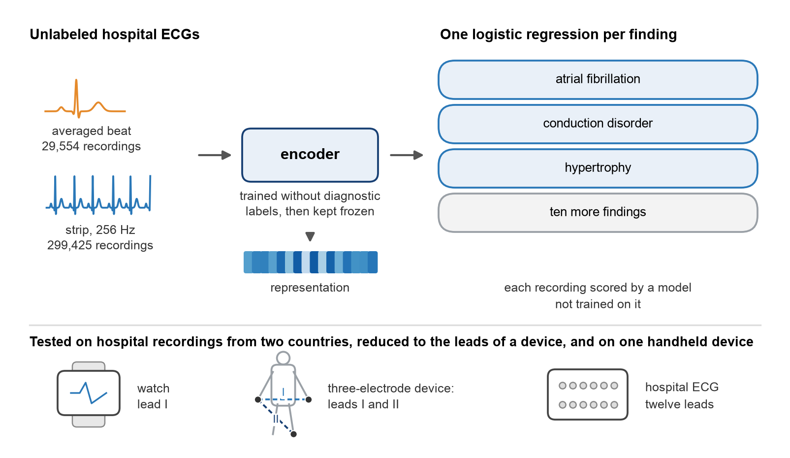
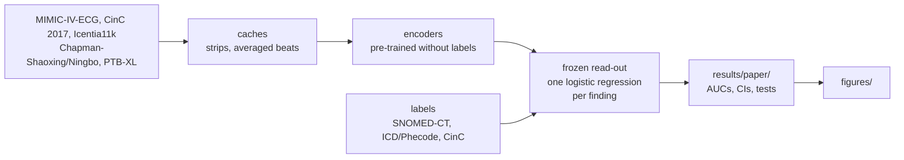

# Lead I alone carries much of what physicians read on a 12-lead ECG

[](LICENSE)
[](LICENSE-FIGURES)


Code, aggregated results and figures for the study *"Lead I alone carries much of what
physicians read on a 12-lead ECG"* by Tim Rahlmeier and Detlef Schoder (Cologne Institute for
Information Systems, University of Cologne).

Cardiologists read many findings from 12-lead electrocardiograms, whereas consumer devices
record one lead and classify only its rhythm. How much diagnostic information does this single
lead carry? We pre-train neural networks with self-supervised learning on unlabelled
MIMIC-IV-ECG recordings, keep them frozen, and read each finding from their representation with
one logistic regression. The main encoder is a masked autoencoder on the whole ten-second strip
(2,560 samples at 256 Hz) of one, two or twelve leads; an autoencoder on the averaged heartbeat,
reproduced from Friedman et al. (2025), is the comparison. The representations are tested
against 13 physician-annotated findings in 44,899 twelve-lead recordings from two hospitals in
China (Chapman–Shaoxing and Ningbo) and in 18,868 from Germany (PTB-XL), on atrial fibrillation
in 5,834 handheld single-lead recordings (PhysioNet/CinC 2017), and on 11 hospital diagnoses of
31,580 MIMIC-IV patients that no encoder saw in pre-training.



*Study overview (Fig. 1 of the paper). The encoder is pre-trained without labels on the averaged
beat or on the strip, then frozen; one logistic regression per finding is fitted on its
representation. The waveforms and devices are drawn for illustration.*

## Key results

| Mean AUC over the findings | Lead I | Leads I and II | Twelve leads |
|---|---|---|---|
| Shaoxing–Ningbo cohort, 13 findings (Chapman–Shaoxing and Ningbo database) | 0.883 | 0.928 | 0.940 |
| PTB-XL, 12 findings (Germany) | 0.838 | 0.886 | 0.897 |

- **Atrial fibrillation on a handheld device** (lead I): RR intervals 0.977, strip 0.971, both
  combined 0.987.
- **Cost of a broad reading:** at a sensitivity of 0.90 for every finding, lead-I classifiers
  flagged 82% of the recordings of the Shaoxing–Ningbo cohort that had none of the 13 findings.

Values are means over training runs. Confidence intervals and every comparison are in
`results/paper/` (see [Where each result lives](#where-each-result-lives)).

## Quick start (no data needed)

```bash
pip install torch==2.6.0 --index-url https://download.pytorch.org/whl/cpu   # or the CUDA wheel, see Environment
pip install -r requirements.txt
python figures/make_figures.py      # redraws the eight figures of the paper from results/paper/
pytest -q                           # unit tests on synthetic signals
```

## Contents

[What is in this repository](#what-is-in-this-repository) ·
[Code map](#code-map) ·
[Environment](#environment) ·
[Data](#data) ·
[Redraw the figures](#redraw-the-figures-no-data-needed) ·
[Tests](#tests) ·
[Running the analysis](#running-the-analysis) ·
[Where each result lives](#where-each-result-lives) ·
[Statistical protocol](#statistical-protocol) ·
[Reproducibility](#reproducibility) ·
[Model weights](#model-weights) ·
[Licence and citation](#licence-and-citation)

## What is in this repository

| Included | Not included |
|---|---|
| all code for preprocessing, pre-training, evaluation and statistics | any ECG data or patient records |
| the aggregated results behind every table and figure (`results/paper/`, `experiments/stats/`) | preprocessed caches, representations and predictions |
| the figures and the script that draws them (`figures/`) | trained model weights (see below) |
| unit tests with negative controls (`tests/`) | the manuscript |

The result tables hold AUCs, confidence intervals, P values and counts per finding and
analysis; they contain no waveforms and no patient-level information. The one per-record file,
`results/paper/handheld_oof.npz`, holds the reference labels and out-of-fold probabilities for
the openly licensed PhysioNet/CinC 2017 recordings, without record names, for the ROC curves of
Fig. 3a.

```
data/               loading, preprocessing (averaged beat, strips), labels, cache builders
data/wearable/      loaders and preprocessing for the handheld, patch and external cohorts
models/             the averaged-beat convolutional autoencoder (architecture of Friedman et al.)
experiments/        encoder pre-training, read-outs and statistics; run scripts
results/paper/      aggregated results (CSV) of every analysis in the paper
experiments/stats/  aggregated results of the cohort tables, the per-lead ranking and the data checks
figures/            make_figures.py and the figures of the paper
tests/              unit tests, including leakage and shuffled-label controls
train.py            training entry point for the averaged-beat autoencoder
```

## Code map

The code and the result files keep the names under which the analyses were run; the paper uses
plainer ones:

| In the code and the result files | In the paper |
|---|---|
| external cohort, `ext`; hospitals `chapman` and `ningbo` | Shaoxing–Ningbo cohort (Chapman–Shaoxing and Ningbo database); hospitals Shaoxing and Ningbo |
| second external cohort, `ptbxl` | PTB-XL |
| handheld encoder, lead-I strip encoder on 300,000 drawn records; `strip` in the result files of the handheld device | full-corpus encoder |
| `strip_icentia` | patch encoder |
| `strip_10k`, `strip_30k`, `strip_60k`, `strip_98k` | corpus-size encoders |
| strip encoders of the 98k corpus for lead I, leads I and II, lead I and V5 and twelve leads; `strip` in the result files of the two 12-lead cohorts | lead-set encoders |
| upright, turned upright | polarity-normalized |
| networks trained with labels: `resnet`, `cnn`, `ft` | supervised networks: residual network, compact network, fine-tuned strip encoder |
| ablation, pairing | controlled-comparison encoders |
| `median`, beat | averaged beat |
| `fusion` | strip + beat |
| `demo` | age and sex alone |

**Preprocessing and labels** (`data/`)

| Module | Role |
|---|---|
| `ecg_paths.py` | locations of the data sets and of the cache directory (environment variables) |
| `preprocessing.py` | the averaged beat of Friedman et al. (2025): R-peak detection, heart-rate normalisation, median beat |
| `wearable/preprocess.py` | the input of an encoder from one or a few leads at any sampling rate: averaged beat or strip; polarity rule of lead I |
| `wearable/loaders.py`, `wearable/label_maps.py` | reading CinC 2017, Icentia11k, Chapman–Shaoxing/Ningbo and PTB-XL; the SNOMED-CT codes of the 13 findings |
| `build_median_cache.py` | MIMIC-IV-ECG averaged beats (training and evaluation) |
| `wearable/build_mimic_leadI_strips.py`, `build_twolead_strip_cache.py`, `wearable/build_icentia_strips.py` | strip corpora: lead I (300,000 drawn records), the 98,000 records of the lead-set comparison, the patch |
| `labels.py`, `build_phecode_lookup.py`, `cohort.py`, `demographics.py` | hospital diagnoses as Phecode phenotypes, dated by encounter start; age, sex and race |
| `mimic_eval_cohort.py` | the hospital cohort: one ECG per patient, outside every pre-training corpus |
| `dataset.py`, `valid_ids.py`, `failures.py` | the training dataset of the averaged beat, the records an encoder can read, counting of failed records |
| `validate_reference_roundtrip.py` | check of the preprocessing against the published reference weights |

**Encoders** (`models/`, `train.py`, `experiments/`)

| Module | Role |
|---|---|
| `models/autoencoder.py`, `train.py` | the averaged-beat autoencoder and its training |
| `experiments/ssl_icentia_wearable.py` | the strip encoder (`ConvMAE1D`), its designs, masks, strip split and masked pre-training |
| `experiments/design_candidates.py` | the candidate strip designs (1,024 or 2,560 samples, width 64 or 128): inputs, pre-training, encoding |
| `experiments/design_selection.py` | the choice of the strip design by nested cross-validation (Supplementary Table S24) |
| `experiments/pretrain_strip_encoders.py` | the full-corpus, corpus-size and patch encoders (lead I) |
| `experiments/twolead_strip_arm.py`, `experiments/ssl_contrastive_strip.py` | strip encoders of one, two and twelve leads at 1,024 samples; the contrastive objective |
| `experiments/ablation_final.py` | the same encoder pre-trained on strips and on their averaged beats (Supplementary Table S15) |
| `experiments/pair_v5_final.py` | lead I paired with the chest lead V5 (Supplementary Table S5) |
| `experiments/encode_external.py` | representations of the Shaoxing–Ningbo cohort from the averaged-beat encoders and the 1,024-sample strip encoders |

**Read-outs and statistics** (`experiments/`)

| Module | Role |
|---|---|
| `common.py` | settings shared by the analyses: one BLAS thread, seeds, groups of findings, the out-of-fold read-out |
| `wearable_oof.py`, `eval_pipeline.py`, `oof_stats.py` | the out-of-fold logistic read-out and its shuffled control; DeLong CIs and paired tests; the hospital labels; the noise analysis |
| `wearable_harness.py`, `wearable_w2_full.py` | frozen encoders, file naming, the inputs of the external cohort |
| `leadset_final.py` | the lead-set comparison in the Shaoxing–Ningbo cohort (Table 1, Fig. 2a) |
| `ptbxl_final.py` | the lead-set comparison in PTB-XL (Table 2, Supplementary Tables S6 to S8) |
| `handheld_final.py`, `cinc2017_features.py`, `rr_intervals.py` | atrial fibrillation on the handheld device (Table 3, Fig. 3) |
| `hospital_final.py`, `recorded_noise.py` | hospital diagnoses and recorded noise (Fig. 5) |
| `comparators_final.py`, `e2b_ecgfm.py` | the supervised networks (residual and compact network, fine-tuned strip encoder) and ECG-FM |
| `secondary_final.py`, `supplement_final.py`, `extras_final.py` | the further analyses of the Shaoxing–Ningbo cohort and the handheld device, and the false alarms of a broad reading (Fig. 4) |
| `describe_data.py`, `cohort_tables.py`, `pairing_corpus_count.py` | counts of the data and cohorts |
| `perlead_ranking.py`, `beat_latents.py`, `seed_stability_report.py` | ranking of the twelve single-lead averaged-beat encoders (Supplementary Table S17) |
| `c2_published_encode.py` | representations from the published averaged-beat encoder of Friedman et al. (Supplementary Table S16) |
| `reproduce_paper.sh`, `train_rpeak_arms.sh`, `train_seed_stability.sh` | the run scripts |

Further modules (`ablation_input_vs_objective.py`, `ablation_second_tasks.py`, `e2_baselines.py`,
`decision_metrics.py`, `recalibration.py`, `rpeak_segmentation_diagnostic.py`,
`wearable_icentia_fidelity.py`) hold functions that these scripts import, and the checks named
in their docstrings.

**Figures** (`figures/`): `make_figures.py` draws every figure from `results/paper/` and
`experiments/stats/`; `figure_base.py` holds the shared style.

## Environment

The results were computed with this setup:

| | |
|---|---|
| OS | Ubuntu 22.04, Linux x86_64 |
| Hardware | 4 × NVIDIA GeForce RTX 4090 (24 GB), 40 CPU cores, driver 555.42.02 |
| Python | 3.12.4 |
| PyTorch | 2.6.0 (CUDA 12.4 wheels) |
| Key packages | numpy 2.1.2, scipy 1.14.1, pandas 2.3.3, scikit-learn 1.5.2, wfdb 4.3.1, biosppy 2.2.4, h5py 3.16.0, statsmodels 0.14.6, matplotlib 3.11.0, pyreadr 0.5.7 |

The full list with pinned versions is in `requirements.txt` and `environment.yml`.

```bash
# conda
conda env create -f environment.yml
conda activate ecg-latent

# or pip: PyTorch first, from the CUDA 12.4 wheel index
pip install torch==2.6.0 --index-url https://download.pytorch.org/whl/cu124
pip install -r requirements.txt
```

A plain `pip install torch` may pull a build for a newer CUDA version than your driver
supports; check with `python -c "import torch; print(torch.cuda.is_available())"`. Without a
GPU, install the CPU wheel (`--index-url https://download.pytorch.org/whl/cpu`): the tests,
the statistics and the figures run on a CPU, the pre-training is impractically slow.

Two parts need extra software:

- **ECG-FM** (`experiments/e2b_ecgfm.py`) runs in a separate environment, because
  `fairseq-signals` pins older libraries. The scripts call it through `ECGFM_PYTHON`
  (default `~/ecgfm_venv/bin/python`):

  ```bash
  python3.12 -m venv ~/ecgfm_venv
  ~/ecgfm_venv/bin/pip install torch==2.2.2 --index-url https://download.pytorch.org/whl/cpu
  ~/ecgfm_venv/bin/pip install transformers==4.44.2 numpy==2.5.1 scipy==1.18.0 \
      scikit-learn==1.9.0 pandas==3.0.3 wfdb==4.3.1 joblib==1.5.3
  git clone https://github.com/Jwoo5/fairseq-signals
  git -C fairseq-signals checkout f8f0ff1c788a82c2059cb452cd5462898867489e
  ~/ecgfm_venv/bin/pip install -e fairseq-signals
  ~/ecgfm_venv/bin/huggingface-cli download wanglab/ecg-fm-preprint \
      mimic_iv_ecg_physionet_pretrained.pt --revision 584219ea492cdeef2e19ffbdf9c6ecc874ba427e
  ```

  The checkpoint is read from the Hugging Face cache; `ECGFM_CKPT` points to another copy.
  torch 2.2.2 was built against NumPy 1.x, so every run prints a warning about NumPy 2; the
  script converts its arrays itself, and the warning is harmless.
- **The published averaged-beat encoder** (`data/validate_reference_roundtrip.py`,
  `experiments/c2_published_encode.py`) needs Keras 3 (PyTorch backend) and a clone of the
  reference model zoo of the Broad Institute ml4h toolkit (https://github.com/broadinstitute/ml4h,
  commit a0803d9; `FRIEDMAN_REF_DIR` points to its `model_zoo/ECG_PheWAS`). It is applied locally
  under its licence, the GNU General Public License, version 3. The weights are
  checked against a pinned SHA-256 and never copied into this repository. The matching test is
  skipped when either is missing.

## Data

No data are included. All data sets are distributed by PhysioNet; MIMIC-IV and
MIMIC-IV-ECG need credentialed access and a signed data use agreement.

| Data set | Version | Used for | Source |
|---|---|---|---|
| MIMIC-IV-ECG | 1.0 | self-supervised pre-training; the hospital cohort | https://physionet.org/content/mimic-iv-ecg/ |
| MIMIC-IV (`hosp` module) | 3.1 | age, sex, race, admissions and the ICD-coded hospital diagnoses | https://physionet.org/content/mimiciv/ |
| Chapman–Shaoxing and Ningbo (`ecg-arrhythmia`) | 1.0.0 | the Shaoxing–Ningbo cohort: 13 findings, one to twelve leads | https://physionet.org/content/ecg-arrhythmia/ |
| PTB-XL | 1.0.3 | the PTB-XL cohort: signals, patients, folds | https://physionet.org/content/ptb-xl/ |
| PhysioNet/CinC Challenge 2021 (`training/ptb-xl`) | 1.0.3 | the SNOMED-CT codes of the PTB-XL statements | https://physionet.org/content/challenge-2021/ |
| PhysioNet/CinC Challenge 2017 | 1.0.0 | handheld single-lead atrial fibrillation | https://physionet.org/content/challenge-2017/ |
| Icentia11k, patients `p00/p00000` to `p00/p00039` | 1.0 | adhesive-patch pre-training corpus | https://physionet.org/content/icentia11k-continuous-ecg/ |
| MIT-BIH Noise Stress Test Database (`nstdb`) | 1.0.0 | recorded noise for the robustness analyses | https://physionet.org/content/nstdb/ |

The code finds the data through three environment variables (defined in `data/ecg_paths.py`):

| Variable | Default | Must contain |
|---|---|---|
| `PHYSIONET_ROOT` | `~/physionet.org/files` | `mimic-iv-ecg/record_list.csv`, `mimic-iv-ecg/files/…`, `mimiciv/3.1/hosp/{patients,admissions,diagnoses_icd,d_icd_diagnoses}.csv`, `ptb-xl/1.0.3/` |
| `WEARABLE_ROOT` | `$PHYSIONET_ROOT` | `challenge-2017/1.0.0/REFERENCE-v3.csv` and `…/training2017/`, `ecg-arrhythmia/1.0.0/`, `challenge-2021/1.0.3/training/ptb-xl/`, `icentia11k-continuous-ecg/1.0/p00/p00000/` … `p00039/`, `nstdb/1.0.0/` |
| `ECG_CACHE_DIR` | `~/ecg-latent-cache` | the two Phecode files below; preprocessed caches, representations and predictions are written here |

Three details differ from a plain PhysioNet download:

- MIMIC-IV-ECG is expected **without** its version directory (`mimic-iv-ecg/record_list.csv`,
  not `mimic-iv-ecg/1.0/record_list.csv`). If your copy keeps it, point `PHYSIONET_ROOT` to a
  directory of links: `mimic-iv-ecg -> <download>/mimic-iv-ecg/1.0`, `mimiciv -> <download>/mimiciv`
  and `ptb-xl -> <download>/ptb-xl`.
- The four MIMIC-IV tables are read uncompressed (`gunzip` the `.csv.gz` files).
- The CinC 2017 recordings come as `training2017.zip`; unzip it in `challenge-2017/1.0.0/`.

The patch corpus uses the first 40 Icentia11k patients; the code stops if fewer are present,
and uses only those 40 if more are.

The hospital diagnoses are defined through the public Phecode map v1.2 (https://phewascatalog.org).
Two files go into `$ECG_CACHE_DIR/phecodes/`; the code checks both against the checksums of the
paper and stops on a mismatch:

| File | Source | SHA-256 |
|---|---|---|
| `vcastro_Phecode_map.rda` | `data/Phecode_map.rda` of the R package vcastro/Phecode (https://github.com/vcastro/Phecode), saved under this name | `a2684dda7cbd48ce92c48af05ec91020a2b99764196101ea41555f13fa2c6027` |
| `phecode_definitions1.2.csv` | the Phecode v1.2 definitions of the PheWAS catalog (https://phewascatalog.org), with the exclusion ranges | `166d73a2cfe2210f60045b30078fee11becbac0faacbf0a0c34fb2066f330cce` |

`data/build_phecode_lookup.py` turns the first into the lookup table `phecode_lookup.csv`.
`data/labels.py` makes two changes to the map. First, ICD-10-CM codes added after v1.2, such
as I48.11, take the phecodes of their nearest listed parent code (I48.1). Second, v1.2 assigns
the ICD-10-CM codes for noncompliance with medication, diet or other treatment (Z91.1) to
chronic kidney disease; only noncompliance with dialysis (Z91.15) keeps that phecode.

**Outcome definitions.** The 13 findings and their SNOMED-CT codes are `ECGARRH_SNOMED_BROAD`
in `data/wearable/label_maps.py`; PTB-XL uses the same codes through the Challenge 2021 headers
(`EQUIVALENT` and `ALIGN` in `experiments/ptbxl_final.py`). The 11 hospital diagnoses are
`CORE_PHENOTYPES` in `experiments/eval_pipeline.py`, each defined by the phecodes of
`PHENOTYPE_PHECODES` in `data/labels.py`; a diagnosis counts as present when the encounter that
coded it began at or before the recording.

Keep the cache directory outside the repository: its contents are derived from credentialed data.

## Redraw the figures (no data needed)

```bash
python figures/make_figures.py
```

This reads only `results/paper/` and `experiments/stats/` and writes the eight figures of the
paper to `figures/`, named after their place in the paper (`fig3.png` is Fig. 3, `figS2.png` is
Supplementary Fig. S2).

## Tests

```bash
pytest -q
```

Run from the repository root. The tests use synthetic signals and tables and need no data;
tests that read a real record, the Phecode files or a trained encoder in `runs/` are skipped
when those are absent. Without data the suite takes a few minutes on a CPU.

## Running the analysis

`experiments/reproduce_paper.sh` runs every step behind the paper in the order the steps
depend on each other (`bash experiments/reproduce_paper.sh caches train` runs only the stages
named). Run it, like every script, from the repository root, and start it on an `ECG_CACHE_DIR`
that holds only the `phecodes/` files: the cache builders refuse to extend a cache made under
other settings, and most steps refuse to overwrite their outputs. The script rewrites the result
tables in `results/paper/` and `experiments/stats/`; `git diff --stat results/paper experiments/stats`
shows what changed. Each script documents its inputs, options and outputs in its module docstring.

On the hardware above, the whole run takes about two and a half to three days: caches about 9 h,
pre-training about 26 to 30 h (most of it the strip encoders, about 70 GPU hours spread over the
four GPUs), the choice of the strip design about 3 h, the supervised networks and the
analyses of the Shaoxing–Ningbo cohort about 7 h each, the hospital analyses about 5 h and the rest a
few hours. The cache directory of the paper's run holds about 125 GB.



The stages, in order:

1. **labels**: the Phecode lookup, the hospital cohort (`data/mimic_eval_cohort.py`: the most
   recent recording of every patient outside all pre-training corpora, kept when a hospital
   encounter began at or before it) and the PTB-XL findings (`ptbxl_final.py labels`).
2. **caches**: averaged beats of the first 30,000 MIMIC-IV-ECG records (`data/build_median_cache.py`),
   strips of 1,024 and 2,560 samples over ten seconds for one, two and twelve leads
   (`data/wearable/build_mimic_leadI_strips.py`, `data/build_twolead_strip_cache.py`,
   `experiments/design_candidates.py build-mimic`), the patch strips, and the inputs of the
   evaluation cohorts (`experiments/wearable_w2_full.py --broad`, `design_candidates.py build-ext`,
   `ptbxl_final.py strips`); the matched corpus of the controlled comparison (`ablation_final.py build`).
3. **train**: the averaged-beat autoencoders (`train.py` through `train_rpeak_arms.sh` and
   `train_seed_stability.sh`) and every strip encoder: the candidate designs of the lead sets
   (`design_candidates.py train`), the full-corpus, corpus-size and patch encoders
   (`pretrain_strip_encoders.py`), the controlled comparison (`ablation_final.py train`) and lead I
   with V5 (`pair_v5_final.py train`). Checkpoints are written to `runs/`.
4. **design**: representations of the Shaoxing–Ningbo cohort (`encode_external.py`, `design_candidates.py
   encode`) and the choice of the strip design by nested cross-validation (`design_selection.py`).
5. **handheld**, **external**, **hospital**, **ptbxl**: the read-outs and statistics of each cohort
   (see the table below).
6. **comparators**: the supervised networks (the residual network, the fine-tuned strip encoder and
   the compact network), with their shuffled-label controls and label budgets (`comparators_final.py`).
7. **other**: counts, encoder size and latency, the handheld table, the cohort tables and the
   summary of every shuffled-label control.
8. **figures**: `figures/make_figures.py`.

Further environment variables (`reproduce_paper.sh` sets the arm variables itself):

| Variable | Meaning |
|---|---|
| `ECG_ARM` | segmentation of the averaged beat: `fixfs` (default: R peaks detected per lead at the true sampling rate), `sharedII` (one R-peak detection on lead II for all leads; needs `ECG_SHARED_RPEAK_LEAD=II` as well), `legacy` (the reference pipeline's detection, for the per-lead ranking only); result files of the averaged beat carry the arm as a suffix |
| `ECG_SHARED_RPEAK_LEAD` | the lead of the shared R-peak detection (`II` for the `sharedII` arm) |
| `ECG_SEED` | which training run of an averaged-beat encoder to evaluate (0, 1, 2) |
| `ECGFM_PYTHON`, `ECGFM_CKPT` | the Python of the ECG-FM environment and the ECG-FM checkpoint |
| `KERAS_PYTHON`, `FRIEDMAN_REF_DIR` | a Python with Keras 3, and the reference model zoo, for the published averaged-beat encoder |
| `NGPU`, `CONCURRENCY` | GPUs used for training (0 … NGPU−1) and averaged-beat training jobs at a time |
| `ECG_LOADER_WORKERS`, `ECG_BLAS_THREADS` | data-loading processes of the strip pre-training; threads of the linear algebra of the per-lead ranking (the other read-outs use one thread) |
| `ECG_ALLOW_OTHER_LADDER`, `ECG_ALLOW_OTHER_PHECODES` | go on although the strip corpus of the lead-set comparison or the Phecode files differ from the paper's |

## Where each result lives

All files are in `results/paper/` unless a folder is named. Files ending in `_per_seed` or
`_s0` … `_s4` hold single training runs; the others report the mean over runs.

| Paper | Files | Written by |
|---|---|---|
| Tables 1 and 2, Fig. 2a, Suppl. Tables S3 and S4 | `leadset_auc`, `leadset_groups`, `leadset_diffs`, `leadset_diff_per_seed_*` | `leadset_final.py` |
| Table 2, Suppl. Tables S2, S6 and S7 (PTB-XL) | `ptbxl_counts`, `ptbxl_auc`, `ptbxl_groups`, `ptbxl_diffs`, `cohort_ptbxl` | `ptbxl_final.py labels`, `eval`; `extras_final.py cohort_ptbxl` |
| Table 3, Fig. 3b, Suppl. Tables S10 and S11 (all approaches, corpus size) | `handheld_auc`, `handheld_summary`, `handheld_diffs`, `handheld_utility`, `table1_handheld` | `handheld_final.py`, `extras_final.py table1` |
| Fig. 2b, Suppl. Tables S18 and S19 | `label_efficiency_frozen`, `label_efficiency_frozen_summary`, `label_efficiency_supervised`, `comparators_auc`, `comparators_groups`, `comparators_vs_frozen*` | `secondary_final.py label_efficiency`, `comparators_final.py eval`, `labeleff` |
| Fig. 3a | `handheld_oof.npz` | `handheld_final.py` |
| Fig. 4, Suppl. Table S13 | `alarms_frontier`, `alarms_burden`, `alarms_per_finding`, `alarms_threshold_transfer`, `alarms_contribution`, `alarms_cumulative` | `secondary_final.py alarms`, `supplement_final.py cumulative` |
| Fig. 5, Suppl. Table S22 | `hospital_noise`, `hospital_noise_s*`, `noise13`, `noise13_per_seed` | `hospital_final.py`, `supplement_final.py noise13` |
| Suppl. Table S1 | `averaged_beat_training_counts`, `averaged_beat_training_counts_other`, `pairing_corpus`, `experiments/stats/cohort_flow` | `describe_data.py`, `pairing_corpus_count.py`, `cohort_tables.py` |
| Table 2, Suppl. Table S9 | `controls` | `extras_final.py controls` |
| Suppl. Table S3 (types of hypertrophy) | `hypertrophy_split` | `supplement_final.py hypertrophy` |
| Suppl. Table S5 | `pair_v5_auc`, `pair_v5_groups`, `pair_v5_diffs` | `pair_v5_final.py eval` |
| Table 2, Suppl. Table S8 (heart rate, AUPRC) | `auprc_per_finding`, `rates_auprc_summary` | `secondary_final.py rates` |
| Table 2, Suppl. Table S8 (PTB-XL by fold) | `ptbxl_by_fold`, `ptbxl_by_fold_per_finding`, `ptbxl_validation_by_fold` | `ptbxl_final.py folds`, `validation` |
| Table 2, Suppl. Table S8 (transfer between hospitals) | `loho_auc`, `loho_summary` | `secondary_final.py loho` |
| Table 2, Suppl. Table S8 (subgroups) | `subgroups`, `subgroups_per_finding` | `extras_final.py subgroups` |
| Suppl. Table S8 (ST changes) | `st_narrow`, `st_elevation_code` | `supplement_final.py st_narrow`, `describe_data.py` |
| Suppl. Table S8 (polarity), Suppl. Note 1 | `upright_external`, `stripext`, `polarity`, `handheld_orientation` | `extras_final.py upright`, `stripext`; `describe_data.py` |
| Suppl. Table S20 | `morphology_auc`, `morphology_vs_strip`, `morphology_vs_strip_per_seed`, `strip_rr_per_finding` | `secondary_final.py morph`, `supplement_final.py strip_rr` |
| Suppl. Table S16, Suppl. Fig. S1 | `beat_hr_auc`, `beat_hr_groups`, `beat_hr_per_finding`, `beat_hr_per_seed` | `supplement_final.py beat_hr` |
| Suppl. Table S17 | `segmentation`, `segmentation_per_run`, `experiments/stats/perlead_ranking_{fixfs,sharedII,legacy}`, `experiments/stats/seed_stability_{fixfs,legacy}`, `experiments/stats/seed_stability_summary` | `supplement_final.py segmentation`, `perlead_ranking.py`, `seed_stability_report.py` |
| Suppl. Table S15 | `ablation_handheld_auc`, `ablation_handheld_diff`, `ablation_external_groups`, `ablation_external_per_seed`, `pairing_corpus` | `ablation_final.py eval`, `pairing_corpus_count.py` |
| Suppl. Table S11 (input length, ECG-FM) | `handheld_length_auc`, `handheld_length_summary`, `handheld_length_diffs`, `handheld_length_inputs`, `ecgfm_auc`, `ecgfm_diffs` | `handheld_final.py length20`, `extras_final.py ecgfm` |
| Suppl. Table S12 | `handheld_ppv`, `handheld_af_vs_all`, `handheld_net_benefit`, `calibration`, `calibration_per_seed` | `extras_final.py handheld`, `calibration` |
| Suppl. Table S14, Suppl. Fig. S2 | `calibration`, `calibration_curves`, `calibration_per_seed`, `recalibration` | `extras_final.py calibration`, `recal` |
| Suppl. Table S21 | `hospital_diagnoses`, `hospital_diagnoses_per_seed` | `hospital_final.py` |
| Suppl. Table S23 | `handheld_tasks`, `handheld_af_vs_all` | `extras_final.py tasks`, `handheld` |
| Suppl. Table S24 | `design_inner`, `design_choice` | `design_selection.py fit`, `choose` |
| Suppl. Table S25, Suppl. Fig. S3 | `experiments/stats/cohorts`, `experiments/stats/cohort_flow`, `ptbxl_flow` | `cohort_tables.py`, `describe_data.py` |
| Suppl. Note 1 | `handheld_duplicates`, `experiments/stats/rpeak_segmentation_summary`, `experiments/stats/wearable_icentia_fidelity_fixfs` | `extras_final.py handheld`, `rpeak_segmentation_diagnostic.py`, `wearable_icentia_fidelity.py` |
| Methods | `ondevice`, `averaged_beat_training_counts`, `af_codes_by_hospital`, `rr_failures_external` | `extras_final.py ondevice`; `describe_data.py` |
| Not reported in the paper | `subgroups_beat`, `subgroups_beat_per_finding` (subgroups of the averaged beat), `strip_rr_groups` (group means of the strip with RR intervals), `handheld_af_vs_all_fp_classes` (false alarms by class of recording), `first30k` (properties of the first 30,000 records of the record list) | `extras_final.py subgroups_beat`, `handheld`; `supplement_final.py strip_rr`; `describe_data.py` |

## Statistical protocol

Every read-out is a logistic regression per finding on the representation with age and sex
(and race for the hospital diagnoses; no class weights), fitted in five patient-grouped outer folds, so no patient contributes to
both the fit and the score; the same folds serve every comparison. The handheld recordings
carry no patient identifiers, so there each recording is its own group. Every encoder is a
single model; the reported value is the mean over its training runs (Supplementary Table S1 gives
their number for every encoder), never an average of predictions. AUCs come with 95%
DeLong confidence intervals per run; means over findings and runs come with a percentile
bootstrap over patients (1,000 draws, seed 0) in which every draw averages the runs. Two
read-outs on the same patients are compared per run with the paired DeLong test, with the
Benjamini–Hochberg false discovery rate over the findings; a difference is consistent in all runs only
when it has the same sign in every run, every run's confidence interval excludes zero and, for
individual findings, every run's q value is below 0.05. Every single-model AUC has a shuffled-label
negative control, trained and scored on the same shuffled labels, which has an expected AUC of 0.5.

## Reproducibility

Random seeds, data splits and folds are fixed, and every read-out runs with one BLAS thread, so
the statistics reproduce bit for bit from the stored representations. Encoder pre-training on a
GPU is not bit-for-bit deterministic, and the trained weights are not shared, so a rerun gives
encoders that differ slightly from ours and AUCs that can differ in the third decimal; the
paper reports means over several runs for that reason. The inputs are pinned more tightly: the
corpus of the lead-set comparison and the Phecode files are checked against SHA-256 checksums of
the paper, and a run stops if they differ, for example because another MIMIC-IV-ECG version is
used.

## Model weights

Trained weights are not part of this repository. The encoders were pre-trained on credentialed
MIMIC-IV-ECG data, and their representations encode patient-stable structure. They are available
on request to researchers with credentialed MIMIC-IV access; credentialed users can also
pre-train them again with this code.

## Licence and citation

Code: GNU General Public License, version 3 or later (`LICENSE`). Figures: CC BY 4.0 (`LICENSE-FIGURES`).
`NOTICE` lists the third-party work this code builds on; the averaged-beat autoencoder
reproduces the architecture of Friedman et al. (2025) and the Broad Institute ml4h toolkit.
If you use this code, please cite the paper and this repository (`CITATION.cff`):

```bibtex
@article{rahlmeier2026leadI,
  author = {Rahlmeier, Tim and Schoder, Detlef},
  title  = {Lead {I} alone carries much of what physicians read on a 12-lead {ECG}},
  year   = {2026},
  note   = {Manuscript submitted for publication}
}
```
