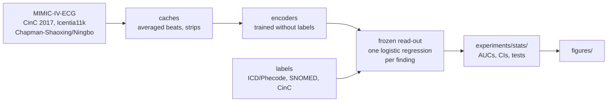

# One ECG lead carries far more than atrial fibrillation

Code, aggregated results and figures for the study *"One ECG lead carries far more than
atrial fibrillation"* by Tim Rahlmeier (University of Cologne).

Smartwatches and handheld devices record one ECG lead and report little beyond atrial
fibrillation, because every further diagnosis needs its own labelled training data. We
train ECG encoders **without any diagnosis** on open hospital recordings (MIMIC-IV-ECG),
keep them frozen, and read each finding from their representation with one logistic
regression. Two encoders are compared: a convolutional autoencoder on the averaged
heartbeat, reproduced from Friedman et al. (2025), and a masked autoencoder on the whole
ten-second strip, which keeps the rhythm. They are tested on a handheld single-lead device
(atrial fibrillation), on an external twelve-lead cohort reduced to one, two and twelve
leads (13 cardiologist-read findings), and on 11 hospital diagnoses of MIMIC-IV patients that
no encoder saw in training.

## What is in this repository

| Included | Not included |
|---|---|
| all code for preprocessing, training, evaluation and statistics | any ECG data or patient records |
| the aggregated results the paper is built from (`experiments/stats/`) | preprocessed caches and extracted features |
| the figures and the script that draws them (`figures/`) | trained model weights (see below) |
| unit tests with negative controls (`tests/`) | the manuscript |

The result tables hold AUCs, confidence intervals, P values and cohort counts per finding;
they contain no waveforms and no patient-level information. The one per-record file,
`experiments/stats/handheld_oof_fixfs.npz`, holds out-of-fold probabilities for the openly
licensed PhysioNet/CinC 2017 recordings; the arrays of the main task come with their public
record names.

```
data/          loading, preprocessing (averaged beat, 1,024-sample strip), labels, cache builders
data/wearable/ loaders and preprocessing for the handheld, patch and external cohorts
models/        the averaged-beat convolutional autoencoder (architecture of Friedman et al.)
experiments/   encoder training for the strip arms, evaluation and statistics; run scripts
experiments/stats/  aggregated results (CSV) for every analysis in the paper
figures/       make_figures.py and the figures of the paper
tests/         unit tests, including leakage and shuffled-label controls
train.py       training entry point for the averaged-beat autoencoder
```

## Code map

**Preprocessing and labels** (`data/`)

| Module | Role |
|---|---|
| `ecg_paths.py` | locations of the data sets and of the cache directory (environment variables) |
| `preprocessing.py` | the averaged beat of Friedman et al. (2025): R-peak detection, heart-rate normalisation, median beat; the segmentation arms |
| `wearable/preprocess.py` | the input of an encoder from one or a few leads at any sampling rate: averaged beat or 1,024-sample strip |
| `wearable/loaders.py`, `wearable/label_maps.py` | reading CinC 2017, Icentia11k and Chapman–Shaoxing/Ningbo; mapping their labels onto the findings |
| `build_median_cache.py` | cache of MIMIC-IV-ECG averaged beats (training and evaluation) |
| `wearable/build_mimic_leadI_strips.py`, `build_twolead_strip_cache.py`, `wearable/build_icentia_strips.py` | strip corpora: lead I (300,000 records), the lead ladder (98,000 records, one, two and twelve leads), the patch |
| `labels.py`, `build_phecode_lookup.py`, `cohort.py`, `demographics.py` | hospital diagnoses as Phecode phenotypes, dated by encounter start; age, sex, race |
| `mimic_eval_cohort.py` | the hospital cohort: one ECG per patient, outside every training corpus |
| `dataset.py`, `valid_ids.py`, `failures.py` | the training dataset, the records an encoder can read, counting of failed records |
| `validate_reference_roundtrip.py` | check of the preprocessing against the published reference weights |

**Encoders** (`models/`, `train.py`, `experiments/`)

| Module | Role |
|---|---|
| `models/autoencoder.py`, `train.py` | the averaged-beat autoencoder and its training (with the divergence guard) |
| `experiments/ssl_icentia_wearable.py` | the strip encoder (`ConvMAE1D`), its masks, the strip split and the masked pre-training |
| `experiments/pretrain_strip_encoders.py` | pre-trains the single-lead strip encoders: corpus sizes, patch corpus, three runs, contrastive variant |
| `experiments/ssl_contrastive_strip.py` | the contrastive strip encoder |
| `experiments/twolead_strip_arm.py`, `experiments/lead_pair_arms.py` | strip encoders of one, two and twelve leads, and of lead I with a chest lead |
| `experiments/ablation_input_vs_objective.py`, `experiments/ablation_second_tasks.py` | the controlled comparison of strip and beat |

**Read-outs and statistics** (`experiments/`)

| Module | Role |
|---|---|
| `wearable_oof.py`, `eval_pipeline.py` | the out-of-fold logistic read-out with its shuffled control; DeLong CIs and paired tests; the hospital labels |
| `wearable_harness.py` | analysis arm in file names, frozen encoders, drop accounting, the loader of the external inputs |
| `cinc2017_features.py`, `rr_intervals.py`, `e2_baselines.py`, `e2b_ecgfm.py`, `e2c_finetune.py` | handheld device: features, RR intervals, supervised network, ECG-FM, fine-tuned strip encoder |
| `strip_length_check.py`, `decision_metrics.py`, `recalibration.py`, `make_e1_figure.py` | handheld device: strip length, screening metrics, calibration |
| `wearable_w2_full.py`, `ecgarrh_features.py`, `onelead_beat_arm.py`, `strip_seed_ensemble.py`, `lead_ladder_stats.py` | external cohort: inputs, averaged beats, the average of three training runs, the lead ladder |
| `perlead_ranking.py`, `beat_latents.py`, `seed_stability_report.py` | hospital cohort: ranking of the twelve single-lead encoders and its training-run control |
| `recorded_noise.py` | hospital cohort: recorded noise from the MIT-BIH NSTDB |
| `oof_stats.py` | AUCs, CIs and paired tests of the main analyses (sections `handheld`, `ablation`, `external`, `groups`, `subgroups`, `noise`) |
| `cohort_tables.py`, `e7_ondevice.py`, `wearable_icentia_fidelity.py`, `rpeak_segmentation_diagnostic.py` | cohort counts and flow, encoder footprint, patch fidelity, segmentation diagnostic |
| `reproduce_paper.sh`, `train_rpeak_arms.sh`, `train_seed_stability.sh` | the run scripts |

**Figures** (`figures/`): `make_figures.py` draws every figure from `experiments/stats/`,
`figure_base.py` holds the shared style.

## Environment

The results were computed with this setup:

| | |
|---|---|
| OS | Ubuntu 22.04, Linux x86_64 |
| Hardware | 4 × NVIDIA GeForce RTX 4090 (24 GB), 40 CPU cores, driver 555.42.02 |
| Python | 3.12.4 |
| PyTorch | 2.6.0 (CUDA 12.4 wheels) |
| Key packages | numpy 2.1.2, scipy 1.14.1, pandas 2.3.3, scikit-learn 1.5.2, wfdb 4.3.1, biosppy 2.2.4, h5py 3.16.0, statsmodels 0.14.6, pyreadr 0.5.7 |

The full list with pinned versions is in `requirements.txt` and `environment.yml`.

```bash
# conda
conda env create -f environment.yml
conda activate ecg-latent

# or pip: PyTorch first, from the CUDA 12.4 wheel index
pip install torch==2.6.0 --index-url https://download.pytorch.org/whl/cu124
pip install -r requirements.txt
```

A plain `pip install torch` may pull a build for a newer CUDA version than your driver
supports; check with `python -c "import torch; print(torch.cuda.is_available())"`. Without a
GPU, install the CPU wheel (`--index-url https://download.pytorch.org/whl/cpu`): the tests,
the statistics and the figures run on a CPU, the encoder training is impractically slow.

Two parts need extra software:

- **ECG-FM baseline** (`experiments/e2b_ecgfm.py`) runs in a separate environment, because
  `fairseq-signals` pins older libraries. The scripts call it through `ECGFM_PYTHON`
  (default `~/ecgfm_venv/bin/python`). The environment of the paper:

  ```bash
  python3.12 -m venv ~/ecgfm_venv
  ~/ecgfm_venv/bin/pip install torch==2.2.2 --index-url https://download.pytorch.org/whl/cpu
  ~/ecgfm_venv/bin/pip install transformers==4.44.2 numpy==2.5.1 scipy==1.18.0 \
      scikit-learn==1.9.0 pandas==3.0.3 wfdb==4.3.1 joblib==1.5.3
  git clone https://github.com/Jwoo5/fairseq-signals
  git -C fairseq-signals checkout f8f0ff1c788a82c2059cb452cd5462898867489e
  ~/ecgfm_venv/bin/pip install -e fairseq-signals
  ~/ecgfm_venv/bin/huggingface-cli download wanglab/ecg-fm-preprint \
      mimic_iv_ecg_physionet_pretrained.pt --revision 584219ea492cdeef2e19ffbdf9c6ecc874ba427e
  ```

  The checkpoint is read from the Hugging Face cache; `ECGFM_CKPT` points to another copy.
  torch 2.2.2 was built against NumPy 1.x, so every run prints a warning about NumPy 2; the
  script converts its arrays itself, and the warning is harmless.
- **Check against the published reference weights** (`data/validate_reference_roundtrip.py`)
  needs Keras 3 and a clone of the reference model zoo of the Broad Institute ml4h toolkit
  (https://github.com/broadinstitute/ml4h, commit a0803d9; `FRIEDMAN_REF_DIR` points to its
  `model_zoo/ECG_PheWAS`). The matching test is skipped when either is missing.

## Data

No data are included. All data sets are distributed by PhysioNet; MIMIC-IV and
MIMIC-IV-ECG need credentialed access and a signed data use agreement.

| Data set | Version | Used for | Source |
|---|---|---|---|
| MIMIC-IV-ECG | 1.0 | label-free encoder training; the hospital cohort | https://physionet.org/content/mimic-iv-ecg/ |
| MIMIC-IV (`hosp` module) | 3.1 | age, sex, race, admissions and the ICD-coded hospital diagnoses | https://physionet.org/content/mimiciv/ |
| PhysioNet/CinC Challenge 2017 | 1.0.0 | handheld single-lead atrial fibrillation | https://physionet.org/content/challenge-2017/ |
| Chapman–Shaoxing and Ningbo (`ecg-arrhythmia`) | 1.0.0 | external cohort, 13 findings, one to twelve leads | https://physionet.org/content/ecg-arrhythmia/ |
| Icentia11k, patients `p00/p00000` to `p00/p00039` | 1.0 | adhesive patch, single lead | https://physionet.org/content/icentia11k-continuous-ecg/ |
| MIT-BIH Noise Stress Test Database (`nstdb`) | 1.0.0 | recorded noise for the robustness analysis | https://physionet.org/content/nstdb/ |

The code finds the data through three environment variables (defined in
`data/ecg_paths.py`):

| Variable | Default | Must contain |
|---|---|---|
| `PHYSIONET_ROOT` | `~/physionet.org/files` | `mimic-iv-ecg/record_list.csv`, `mimic-iv-ecg/files/…`, `mimiciv/3.1/hosp/{patients,admissions,diagnoses_icd,d_icd_diagnoses}.csv` |
| `WEARABLE_ROOT` | `$PHYSIONET_ROOT` | `challenge-2017/1.0.0/REFERENCE-v3.csv` and `…/training2017/`, `ecg-arrhythmia/1.0.0/`, `icentia11k-continuous-ecg/1.0/p00/p00000/` … `p00039/`, `nstdb/1.0.0/` |
| `ECG_CACHE_DIR` | `~/ecg-latent-cache` | the two Phecode files below; preprocessed caches and features are written here |

Three details differ from a plain PhysioNet download:

- MIMIC-IV-ECG is expected **without** its version directory (`mimic-iv-ecg/record_list.csv`,
  not `mimic-iv-ecg/1.0/record_list.csv`). If your copy keeps it, point `PHYSIONET_ROOT` to a
  directory of links: `mimic-iv-ecg -> <download>/mimic-iv-ecg/1.0` and
  `mimiciv -> <download>/mimiciv`.
- The four MIMIC-IV tables are read uncompressed (`gunzip` the `.csv.gz` files).
- The CinC 2017 recordings come as `training2017.zip`; unzip it in `challenge-2017/1.0.0/`.

The patch analyses use the first 40 Icentia11k patients; the code stops if fewer are present,
and uses only those 40 if more are.

The hospital diagnoses are defined through the public Phecode map v1.2 (https://phewascatalog.org).
Two files go into `$ECG_CACHE_DIR/phecodes/`; the code checks both against the checksums of the
paper and stops on a mismatch:

| File | Source | SHA-256 |
|---|---|---|
| `vcastro_Phecode_map.rda` | `data/Phecode_map.rda` of the R package vcastro/Phecode (https://github.com/vcastro/Phecode), saved under this name | `a2684dda7cbd48ce92c48af05ec91020a2b99764196101ea41555f13fa2c6027` |
| `phecode_definitions1.2.csv` | the Phecode v1.2 definitions of the PheWAS catalog (https://phewascatalog.org), with the exclusion ranges | `166d73a2cfe2210f60045b30078fee11becbac0faacbf0a0c34fb2066f330cce` |

`data/build_phecode_lookup.py` turns the first into the lookup table `phecode_lookup.csv`.
`data/labels.py` makes two changes to the map. First, ICD-10-CM codes added after v1.2, such
as I48.11, take the phecodes of their nearest listed parent code (I48.1). Second, v1.2 assigns
the ICD-10-CM codes for noncompliance with medication, diet or other treatment (Z91.1) to
chronic kidney disease; only noncompliance with dialysis (Z91.15) keeps that phecode.

**Outcome definitions.** The 13 findings of the external cohort and their SNOMED-CT codes are
`ECGARRH_SNOMED_BROAD` in `data/wearable/label_maps.py`. The 11 hospital diagnoses are
`CORE_PHENOTYPES` in `experiments/eval_pipeline.py`, each defined by the phecodes of
`PHENOTYPE_PHECODES` in `data/labels.py`; a diagnosis counts as present when the encounter
that coded it began at or before the recording.

Keep the cache directory outside the repository: its contents are derived from credentialed data.

## Redraw the figures (no data needed)

```bash
python figures/make_figures.py
```

This reads only `experiments/stats/` and writes all eight figures of the paper to
`figures/`, named after their place in the paper (`fig3_findings.png` is Fig. 3,
`figS1_ladder.png` is Supplementary Fig. S1).

## Tests

```bash
pytest -q
```

Run from the repository root. The tests use synthetic signals and tables and need no data;
tests that read a real record, the Phecode files or a trained encoder in `runs/` are skipped
when those are absent. Without data the suite takes about 2 minutes on a CPU.

## Running the analysis

`experiments/reproduce_paper.sh` runs every step behind the paper in the order the steps
depend on each other (`bash experiments/reproduce_paper.sh caches train` runs only the stages
named). Run it, like every script, from the repository root. Start it on an `ECG_CACHE_DIR`
that holds only the `phecodes/` files: the cache builders refuse to extend a cache made under
other settings. On the hardware above the stages took about 6 h (caches), 12 h
(training) and 5 h (everything else), and the cache grew to about 60 GB. The script rewrites
the result tables in `experiments/stats/`; `git diff --stat experiments/stats` shows what
changed. Each script documents its inputs, options and outputs in its module docstring. The
main steps, in order:



1. **Preprocess MIMIC-IV-ECG.** `data/build_median_cache.py` extracts the averaged beats
   (600 samples per lead; `--leads`, `--per-lead` and `--orient` select what an encoder sees);
   `data/wearable/build_mimic_leadI_strips.py` and `data/build_twolead_strip_cache.py --ladder` build the
   strips (1,024 samples covering ten seconds) for one, two and twelve leads.
   `data/mimic_eval_cohort.py` lists the hospital cohort: the most recent recording of every
   patient outside all training corpora, kept when a hospital encounter (emergency-department
   registration or admission) began at or before it; `data/build_phecode_lookup.py` builds the
   ICD-to-Phecode lookup. The corpus sizes of the paper are set by the options in
   `reproduce_paper.sh` (for example `build_median_cache.py --limit 30000`; without `--limit`
   that builder stops after 500 records, for prototyping).
2. **Train the encoders.** `train.py` trains the averaged-beat autoencoder
   (`experiments/train_rpeak_arms.sh` and `experiments/train_seed_stability.sh` run the lead
   sets, segmentations and training runs of the paper). `experiments/pretrain_strip_encoders.py`
   pre-trains the single-lead strip encoders of the handheld analyses (all corpus sizes, the
   patch corpus, three runs, the contrastive variant), `experiments/twolead_strip_arm.py
   --stage pretrain` the one-, two- and twelve-lead strip encoders of the lead ladder,
   `experiments/lead_pair_arms.py` the chest-lead pairs and
   `experiments/ablation_input_vs_objective.py` the controlled comparison. Checkpoints are
   written to `runs/`.
3. **Extract representations and fit the read-outs.** `experiments/cinc2017_features.py`,
   `experiments/e2_baselines.py`, `experiments/e2b_ecgfm.py` and `experiments/e2c_finetune.py`
   (handheld device), `experiments/wearable_w2_full.py --broad` (inputs of the
   external cohort; a recording is dropped for every input when a beat encoder would see no
   detected lead), `experiments/twolead_strip_arm.py --stage external`,
   `experiments/lead_pair_arms.py`, `experiments/onelead_beat_arm.py`,
   `experiments/strip_length_check.py` and `experiments/perlead_ranking.py` (per-lead ranking
   on the hospital diagnoses, with `--runs` for the training-run controls).
4. **Statistics.** `experiments/oof_stats.py` (sections `handheld`, `ablation`, `external`,
   `groups`, `subgroups`, `noise`), `experiments/strip_seed_ensemble.py`,
   `experiments/lead_ladder_stats.py`, `experiments/recalibration.py`,
   `experiments/seed_stability_report.py`, `experiments/cohort_tables.py`,
   `experiments/e7_ondevice.py`, `experiments/wearable_icentia_fidelity.py` and
   `experiments/rpeak_segmentation_diagnostic.py`. They write `experiments/stats/`.
5. **Figures.** `figures/make_figures.py`.

Further environment variables (`reproduce_paper.sh` sets the arm variables itself):

| Variable | Meaning |
|---|---|
| `ECG_ARM` | preprocessing arm of the averaged beat: `fixfs` (primary and default: R peaks detected at the true sampling rate), `sharedII` (sensitivity analysis: one R-peak detection on lead II for all leads; needs `ECG_SHARED_RPEAK_LEAD=II` as well), `legacy` (the reference pipeline's detection, for the per-lead ranking only); result files carry the arm as a suffix |
| `ECG_SHARED_RPEAK_LEAD` | the lead of the shared R-peak detection (`II` for the `sharedII` arm) |
| `ECG_SEED` | which training run of an encoder to evaluate (0, 1, 2) |
| `ECGFM_PYTHON`, `ECGFM_CKPT` | the Python of the ECG-FM environment and the ECG-FM checkpoint |
| `NGPU`, `CONCURRENCY` | GPUs used for training (0 … NGPU−1) and training jobs at a time |
| `ECG_WORKERS`, `ECG_LOADER_WORKERS`, `ECG_BLAS_THREADS` | parallelism of the read-outs, the strip data loaders and the linear algebra |
| `ECG_ALLOW_OTHER_LADDER`, `ECG_ALLOW_OTHER_PHECODES` | go on although the lead-ladder corpus or the Phecode files differ from the paper's (see below) |
| `FRIEDMAN_REF_DIR` | the reference model zoo for `data/validate_reference_roundtrip.py` (optional, see Environment) |

### Where each result lives

| Analysis | Paper | Files in `experiments/stats/` | Written by |
|---|---|---|---|
| handheld device, atrial fibrillation | Table 1, Figs. 2 and 4, Suppl. Fig. S2, Suppl. Tables S2 and S16 | `handheld_auc`, `handheld_diff`, `handheld_utility`, `handheld_oof` | `oof_stats.py` |
| length of the strip | Suppl. Table S3 | `strip_length_auc`, `strip_length_diff` | `strip_length_check.py` |
| input against objective (controlled ablation) | Suppl. Table S4 | `ablation_auc`, `ablation_diff` | `oof_stats.py` (encoders from `ablation_input_vs_objective.py`) |
| external cohort, averaged beat | Suppl. Tables S5, S10 and S13 | `external_auc`, `external_diff`, `external_groups` | `oof_stats.py` |
| external cohort, strips, 1 / 2 / 12 leads | Table 2, Fig. 3, Suppl. Tables S6, S9 and S11 | `onelead_strip_*`, `twolead_strip_*`, `12lead_strip_*` | `twolead_strip_arm.py`, `strip_seed_ensemble.py` |
| external cohort, averaged beat, one lead | Table 2, Suppl. Table S8 | `onelead_auc`, `onelead_diff` | `onelead_beat_arm.py` |
| lead I with a chest lead | Suppl. Table S12 | `pair_I_V5_*`, `pair_I_V2_*` | `lead_pair_arms.py` |
| lead ladder | Table 2, Suppl. Fig. S1, Suppl. Table S7 | `lead_ladder`, `ladder_diff` | `lead_ladder_stats.py` |
| subgroups | Suppl. Table S15 | `subgroups_auc` | `oof_stats.py` |
| recalibration | Suppl. Table S14 | `recalibration` | `recalibration.py` |
| recorded noise | Fig. 5 | `noise_auc` | `oof_stats.py` |
| per-lead ranking, training-run control | Methods (Preprocessing) | `perlead_ranking_<arm>`, `seed_stability_<arm>`, `seed_stability_summary` | `perlead_ranking.py`, `seed_stability_report.py` |
| encoder size, patch fidelity, segmentation | Methods | `e7_ondevice`, `wearable_icentia_fidelity`, `rpeak_segmentation_summary` | `e7_ondevice.py`, `wearable_icentia_fidelity.py`, `rpeak_segmentation_diagnostic.py` |
| cohorts and exclusions | Suppl. Table S17, Suppl. Fig. S3 | `cohorts`, `cohort_flow` | `cohort_tables.py` |
| negative controls | Suppl. Table S1 | the `shuffled` columns of the files above | |

Files ending in `_s0`, `_s1`, `_s2` hold a single training run; the file without that
suffix averages the out-of-fold probabilities of the three runs.

## Statistical protocol

Every read-out is a logistic regression per finding (no class weights), fitted in patient-grouped five-fold
cross-validation, so no patient contributes to both the fit and the score. The handheld
recordings (PhysioNet/CinC 2017) carry no patient identifiers, so there each recording is
its own group. AUCs come with
95% DeLong confidence intervals; two read-outs on the same patients are compared with the
paired DeLong test; P values across findings are controlled with the Benjamini–Hochberg
false discovery rate. Every AUC of a single training run on a whole cohort has a
shuffled-label negative control, trained and scored on the same permuted labels, which must give
an AUC near 0.5; averages of three runs are covered by the controls of their runs, the per-lead
ranking averages its controls over the 11 diagnoses of each encoder, and subgroups carry none.

## Reproducibility

Random seeds, data splits and validation masks are fixed, but encoder training on a GPU is
not bit-for-bit deterministic (cuDNN chooses its algorithms at run time), and the trained
weights are not shared. A rerun therefore gives encoders that differ slightly from ours, and
AUCs that can differ in the third decimal; the comparisons of the paper average three training
runs where that matters. The inputs are pinned more tightly: the lead-ladder corpus and the
Phecode files are checked against SHA-256 checksums of the paper, and a run stops if they
differ, for example because another MIMIC-IV-ECG version is used.

## Model weights

Trained weights are not shared. The encoders were trained on credentialed MIMIC-IV-ECG data,
and their representations encode patient-stable structure. Credentialed users can retrain
them with this code.

## Licence and citation

Code: GNU General Public License, version 3 or later (`LICENSE`). Figures: CC BY 4.0 (`LICENSE-FIGURES`).
`NOTICE` lists the third-party work this code builds on; the averaged-beat autoencoder
reproduces the architecture of Friedman et al. (2025) and the Broad Institute ml4h toolkit.
If you use this code, please cite the paper and this repository (`CITATION.cff`).
